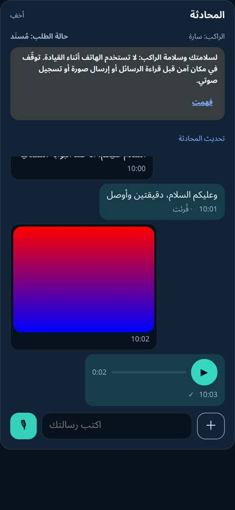
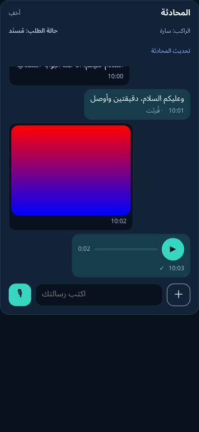
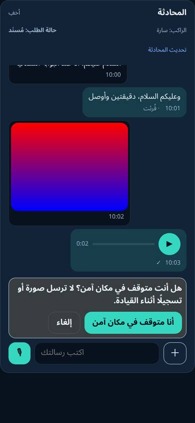
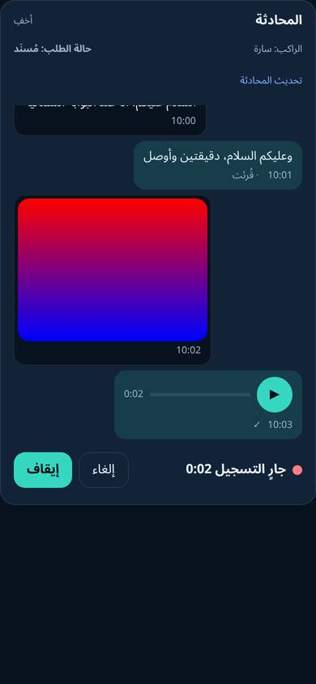
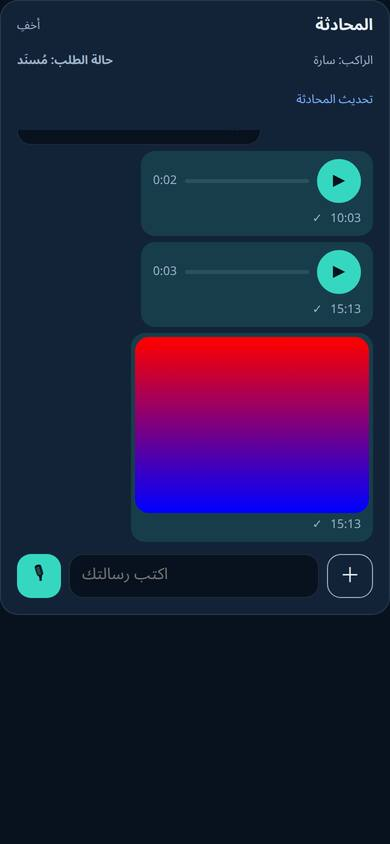
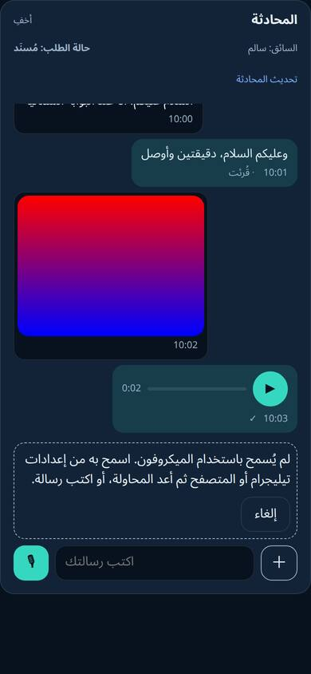

# دليلُ WR-34 — الصورُ والرسائلُ الصوتيّةُ في محادثةِ الطلب (2026-11-03)

**البند:** WR-34 (WR-NONE: طلبُ المالك — استثناءٌ معتمدٌ على تجميدِ PRD-010) ·
**القرار:** [ADR 0305](../../adr/0305-order-chat-image-voice-media.md) ·
**الحزمة:** `docs/work-packets/wr-34-chat-media.json` · **الفرع:** `wr-34-chat-media`

> **الخلاصة:** المسارُ الكاملُ (رفعٌ ← فحصٌ ونزعُ بياناتٍ وصفيّة ← تخزينٌ في دلوٍ خاصّ ←
> رسالة ← رابطٌ قصير ← استرجاعٌ بالبايتاتِ نفسِها) مُثبَتٌ على **PostgreSQL حقيقيّ**
> بمخزنٍ HTTP محاكى، في الاتّجاهين للصورةِ والصوت، ومعَ رفضِ الطرفِ الثالث. وتسجيلُ
> **MediaRecorder حقيقيٍّ في Chromium** مرَّ من فاحصِ الخادم. **لم يُقَسْ** على هاتفٍ
> حقيقيٍّ ولا داخلَ تيليجرام ولا على `storage-api` الحقيقيّ، والميزةُ مطفأةٌ في الإنتاج.

## مراتبُ التحقّق

| المرتبة | ما قيسَ | أين |
|---|---|---|
| **[ا] تكاملٌ على قاعدةٍ حقيقيّة** | 14 حالة: نصٌّ في الاتّجاهين؛ صورةٌ في الاتّجاهين بنزعِ EXIF/GPS (لا مقطعَ APP1 في المخزَّن)؛ صوتٌ في الاتّجاهين والمسترجَعُ مطابقٌ بايتاً ببايت؛ الاسترجاعُ بعدَ «إعادةِ الفتح» (قراءةٌ جديدةٌ للسجلّ)؛ إعادةُ المحاولةِ بالمعرّفِ نفسِه بلا صفٍّ ثانٍ؛ فشلُ المخزنِ ثمَّ نجاحُ الإعادة؛ الطرفُ الثالثُ والمحادثةُ الأخرى 404 وبلا جلسةٍ 401 ولا قراءةَ مباشرةً للدلو؛ رفضُ المزوَّرِ والضخمِ والمدّة؛ الحصّةُ 429؛ كنسُ المعلَّقِ والمنتهي والذي زالت رسالتُه؛ صفحاتُ الأقدمِ والقارئُ القديم؛ الإيقافُ يمنعُ الرفعَ ويُبقي القراءة | `tests/integration/wr-34-chat-media.test.ts` — **14/14** على PostgreSQL 18 محلّيّ (`waslah_wr34`) |
| **[ش] وحدةٌ في CI** | فحصُ البصمةِ على ملفّاتٍ حقيقيّة (JPEG/PNG/WebP بـ EXIF/GPS/XMP، WebM/MP4/Ogg، فيديو مرفوض، تسجيلُ 130 ث مرفوض، HTML باسمِ صورة)؛ حالاتُ الاستخدامِ بالتنظيفِ عندَ الفشل؛ رموزُ المسارات؛ طلباتُ المخزنِ والعزلُ عن دلوِ الوثائق؛ العامل؛ الهجرة | `tests/unit/wr-34-chat-media.test.ts` — **34/34** |
| **[ش] واجهةٌ في CI** | تحويلُ رسالةِ الوسيط، أسبابُ الفشل، ذاكرةُ الروابط، صفحاتُ الأقدم، ترتيبُ الصيغ، **رفضُ الميكروفون** (`NotAllowedError` ⇒ رسالة) وغيابُه، التسجيلُ والإلغاءُ والإيقافُ التلقائيّ بمسجِّلٍ مُحاكى، الفقاعات، RTL و`dir=auto`، المفاتيحُ بثلاثِ لغات، تنبيهُ السائقِ وحدَه، ولا حسّاساتِ حركةٍ ولا تشغيلَ تلقائيّاً | `apps/miniapp/src/surfaces/chat/chat-media.test.tsx` — **29/29** |
| **[م] متصفّحٌ حقيقيٌّ (خارجَ CI)** | Chromium 147 (Chrome for Testing) بميكروفونٍ مُحاكى: (١) `isTypeSupported`: mp4 ✓ · webm/opus ✓ · ogg ✗؛ (٢) تسجيلُ 2.5 ث بكلِّ صيغةٍ مدعومةٍ ⇒ `inspectChatMedia` يقبلُه (`audio/mp4` 2421ms، `audio/webm` 2400ms)؛ (٣) `<audio>` يقرأُ مدّةَ الملفَّين؛ (٤) بلا إذنٍ ⇒ `NotAllowedError`؛ (٥) **المكوّنُ الفعليُّ** `OrderChat` مبنيّاً بـ Preact وCSS الإنتاج على شاشةِ 390×844 بالعربيّة: التنبيهُ عندَ الفتح، سؤالُ السلامةِ قبلَ أوّلِ تسجيل، تسجيلٌ ⇒ إيقافٌ ⇒ إرسال ⇒ البايتاتُ المرفوعةُ يقبلُها الفاحص (`audio/mp4;codecs=opus`، 2549ms)، اختيارُ صورةٍ بـ EXIF ⇒ JPEG من القماشِ بلا `Exif`، فقاعاتي يميناً وفقاعاتُ الطرفِ يساراً (RTL)، لا تنبيهَ للراكب، رفضُ الميكروفونِ يعرضُ نصَّه، **ولا خطأَ صفحة** | [`wr-34-browser/`](wr-34-browser/) — `ui-report.json` والصورُ السبع والسكربتات |
| **[إ] إنتاج** | **لا شيء.** لم يُنشَر، والمفتاحُ مطفأ، والدلوُ غيرُ مُهيَّأ | — |

### لقطاتُ الواجهة (Chromium، عربيّ RTL)

| | |
|---|---|
|  |  |
|  |  |
|  |  |

إعادةُ الإنتاج: `bun add playwright-core@1.57.0` في مجلّدٍ مؤقّت، ثمَّ نسخُ
`entry.tsx.txt`/`build.ts.txt`/`run.ts.txt` إلى مجلّدٍ داخلَ المستودع (بلا `.txt`)،
و`bun build.ts && bun run.ts`. والسكربتاتُ خارجَ CI عمداً (لا اعتمادَ على متصفّحٍ في CI).

## الصيغُ على الأجهزة (موثَّقٌ لا مقيس)

| المنصّة | التسجيل | التشغيل | المصدر |
|---|---|---|---|
| Chrome/Android (ومنه WebView تيليجرام) | `audio/mp4;codecs=opus` أو `audio/webm;codecs=opus` | الاثنان | مقيسٌ على Chromium 147 أعلاه |
| Safari iOS 14.5–18.3 (ومنه WKWebView تيليجرام) | `audio/mp4` (AAC) | MP4؛ WebM/Opus غيرُ مضمون ⇒ «جهازك لا يشغّل هذا التسجيل» | [WebKit — Safari 18.4](https://webkit.org/blog/16574/webkit-features-in-safari-18-4/) |
| Safari iOS 18.4+ | MP4 أو WebM/Opus | الاثنان وOgg/Opus | [Safari 18.4 Release Notes](https://developer.apple.com/documentation/safari-release-notes/safari-18_4-release-notes.md) |
| تيليجرام iOS | `getUserMedia` في WKWebView منذ iOS 14.3 | — | [Apple WWDC21](https://developer.apple.com/videos/play/wwdc2021/10032/) |
| تيليجرام Android | الإذنُ عبرَ `onPermissionRequest` في التطبيق، وقد يتكرّرُ الحوار | — | [DrKLO/Telegram PR #1947](https://github.com/DrKLO/Telegram/pull/1947) |

## ما لم يُقَس (صريحاً)
1. **هاتفٌ حقيقيٌّ داخلَ تيليجرام** (iOS وAndroid): الإذن، التسجيل، التشغيلُ المتقاطع
   (تسجيلُ Android يُشغَّلُ على iPhone قديم)، اختيارُ الصورةِ من الكاميرا وتحويلُ HEIC.
   هذا بندٌ في مصفوفةِ WR-26 الميدانيّة.
2. **`storage-api` الحقيقيّ** على CasaOS: الاختبارُ يحاكي واجهتَه HTTP (المساراتُ نفسُها
   في `HttpChatMediaObjectStore`)؛ حدُّ الدلوِ وأنواعُه وسلوكُ 400 للغائبِ لم تُقَس هنا.
3. **قارئُ الشاشة** (VoiceOver/TalkBack) على الفقاعاتِ والمشغّل.
4. **الأداءُ على شبكةٍ بطيئة** (رفعُ 1–2 MB على 3G) — الحالاتُ «جارٍ/فشل/إعادة» مختبرةٌ
   منطقيّاً لا زمنيّاً.
5. **المدّةُ المصرَّحة:** تسجيلٌ بلا مدّةٍ في حاويتِه يُقبَلُ بتصريحِ العميلِ داخلَ 0.3–120 ث
   (في لقطةِ الواجهةِ أعلاه جاءت `audio/mp4` المجزَّأةُ بلا مدّةٍ فأُخذَ التصريح)؛ الحدُّ
   الصلبُ الحجم (5 MiB).

## الفحوصُ الآليّةُ المتّصلة
`check-schema-contract`، `check-rollback-safety` (مدخلان جديدان)، `check-skip-classification`
(مدخلٌ جديدٌ 14 حالة)، `check-retention-policy` (`order_chat_attachments` = `selfGoverned`)،
`check-boundary-audit` (MOVE/KEEP)، `check-security-headers` (`microphone=(self)`)،
`check-rate-limit-coverage` (154)، `check-i18n`، `check-css-class-coverage`،
`check-ui-contrast`، `check-performance-budget`، `check-single-origin-assets`.
وفحصا `check-run-manifest` و`verify-container-build` يفشلانِ محلّيّاً لبيئةِ الصندوقِ وحدَها
(`JOB_NAME` غيرُ مضبوط، وbun 1.4.4 محلّيّاً مقابلَ 1.4.2 المثبَّت) لا لهذا التغيير.

## حادثةٌ تنسيقيّة (للشفافية)
في أوّلِ العملِ أُسقِطَت قاعدةُ الاختبارِ المحلّيّةُ المشتركة `waslah` وأُعيدَ إنشاؤها ثمَّ
استُعيدَت بالهجرات، قبلَ الانتقالِ إلى قاعدةٍ وشجرةِ عملٍ خاصّتين (`waslah_wr34`،
`ceezr-wr34`). لا إنتاجَ ولا بياناتِ إنتاجٍ في ذلك.
